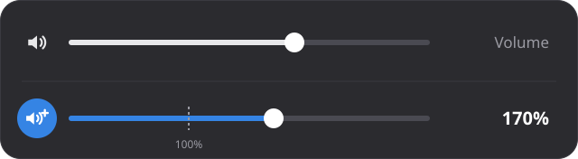
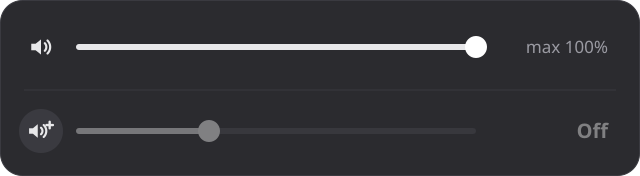

<div align="center">

# Louder

**Boost your speaker volume up to 300% on GNOME, right from the Quick Settings menu.**

[](#requirements)
[](LICENSE)
[](https://github.com/saikatnjm/louder/releases/latest)

[Website](https://saikatnjm.github.io/louder/) ·
[Download](https://github.com/saikatnjm/louder/releases/latest) ·
[Report a problem](https://github.com/saikatnjm/louder/issues)



</div>

---

## Contents

- [Features](#features)
- [Requirements](#requirements)
- [Install](#install)
- [How to use](#how-to-use)
- [Settings](#settings)
- [Troubleshooting](#troubleshooting)
- [Uninstall](#uninstall)
- [Building from source](#building-from-source)
- [How it works](#how-it-works)
- [License](#license)

## Features

- **Up to 300% volume.** GNOME's own slider stops at 150%. Louder goes to 300%.
- **Shows the exact percentage** next to the slider.
- **Sticks to 100%** when you drag near it, so getting back to normal is easy.
- **On/off switch.** Click the slider's speaker icon to turn the boost off. Both
  sliders then stop at 100%.
- **Remembers your choice** after logging out, restarting or locking the screen.
- **Follows your active speaker:** built-in speakers, Bluetooth, HDMI or USB.
- **Stays in sync** with the volume keys and GNOME's own volume slider.
- **Tiny:** about 150 lines of plain JavaScript, with no dependencies.

## Requirements

- GNOME Shell **48, 49 or 50**, for example Ubuntu 25.04 or newer, or Fedora 42 or newer.
- PipeWire or PulseAudio, which all current distributions use.

## Install

Louder is **off after installing**. You turn it on yourself (step 4 below).

### Option 1: Double-click the .deb (Ubuntu, Debian)

1. Download `gnome-shell-extension-louder_<version>_all.deb` from the
   [latest release](https://github.com/saikatnjm/louder/releases/latest).
2. Double-click it and press **Install** in App Center.
3. Log out and log back in.
4. Open the **Extensions** app and turn on **Louder**.

### Option 2: Zip file (any distribution)

Download `louder@saikat.shell-extension.zip` from the
[latest release](https://github.com/saikatnjm/louder/releases/latest), then run:

```bash
gnome-extensions install louder@saikat.shell-extension.zip
```

Log out and back in, then turn on **Louder** in the **Extensions** app, or run:

```bash
gnome-extensions enable louder@saikat
```

### Option 3: From source

```bash
git clone https://github.com/saikatnjm/louder.git
cd louder
make install
```

Log out and back in, then turn it on as in Option 2.

> **Why log out?** On Wayland, GNOME only loads newly installed extensions at login.

## How to use

1. Click the top-right corner of the screen to open **Quick Settings**.
2. The **Louder** slider sits below the regular volume slider. Drag it to set the
   volume anywhere from 0% to 300%.
3. **Click the speaker icon** on the Louder slider to turn the boost on or off.

<div align="center">

</div>

| | Boost **on** (blue icon) | Boost **off** (grey icon) |
|---|---|---|
| Louder slider | 0–300% | Greyed out, shows **Off** |
| Regular volume slider | 0–150% | 0–100% |
| Volume above 100% | Allowed | Lowered to 100% when you switch off |

> **Note:** Volumes above about 150–200% can make sound distort or crackle,
> especially on small speakers. If that happens, turn it down.

## Settings

**Maximum boost:** edit `MAX_BOOST` near the top of [`extension.js`](extension.js)
(`3.0` means 300%), then reinstall with `make install` and log out and back in.

**On/off from the terminal:**

```bash
# with the .deb installed:
gsettings --schemadir /usr/share/gnome-shell/extensions/louder@saikat/schemas \
  set org.gnome.shell.extensions.louder boost-enabled false
# with the zip or source install:
gsettings --schemadir ~/.local/share/gnome-shell/extensions/louder@saikat/schemas \
  set org.gnome.shell.extensions.louder boost-enabled false
```

## Troubleshooting

**The Louder slider doesn't appear.**
Log out and back in after installing, then check it is turned on:

```bash
gnome-extensions info louder@saikat
```

If it says `State: ERROR`, the log shows why:

```bash
journalctl --user -b -g louder --no-pager | tail -20
```

Please include that output when you [report a problem](https://github.com/saikatnjm/louder/issues).

**The regular slider still goes above 100% with boost off.**
Another extension may be switching GNOME's "Over-Amplification" setting back on,
for example another volume booster. Turn that extension off, then switch Louder's
boost off and on once.

**Sound crackles at high volume.**
This is clipping: the sound is louder than the speaker can play cleanly. It
happens with every volume booster. Lower the volume until it stops.

## Uninstall

- **Installed the .deb:**
  ```bash
  sudo apt remove gnome-shell-extension-louder
  ```
- **Installed the zip or from source:** remove it in the **Extensions** app, or run
  `make uninstall` in the source folder.

When Louder is turned off or removed, it puts GNOME's Over-Amplification setting
back the way it was before.

## Building from source

```bash
make        # build both packages into build/
make zip    # build/louder@saikat.shell-extension.zip
make deb    # build/gnome-shell-extension-louder_<version>_all.deb
make install    # install for your account only
make uninstall  # remove it
make clean      # delete build/
```

`make zip` needs `gnome-extensions`, which comes with GNOME. `make deb` also needs
`dpkg-deb` and `glib-compile-schemas`, which come with Ubuntu and Debian.

**Making a release:** bump `"version"` in [`metadata.json`](metadata.json), add an
entry to [`CHANGELOG.md`](CHANGELOG.md), run `make`, then attach both files in
`build/` to a new [GitHub release](https://github.com/saikatnjm/louder/releases/new).

## How it works

Louder adds a slider to GNOME's Quick Settings menu. It uses the same audio
mixer as GNOME's own volume slider, but lets the volume go up to 300% instead
of 150%. Above 100%, PipeWire or PulseAudio amplifies the sound in software.

The on/off switch also controls GNOME's built-in
`org.gnome.desktop.sound allow-volume-above-100-percent` setting, which decides
whether the regular volume slider can go past 100%.

| File | What it is |
|---|---|
| [`extension.js`](extension.js) | The extension |
| [`metadata.json`](metadata.json) | Name, ID, version and supported GNOME versions |
| [`schemas/`](schemas) | The saved on/off setting |
| [`Makefile`](Makefile) | Builds the .zip and .deb |
| [`packaging/control`](packaging/control) | Details shown when installing the .deb |
| [`docs/`](docs) | The [website](https://saikatnjm.github.io/louder/) |

## License

Louder is free software under the
[GNU General Public License v2.0 or later](LICENSE).
See [CHANGELOG.md](CHANGELOG.md) for what changed in each version.
